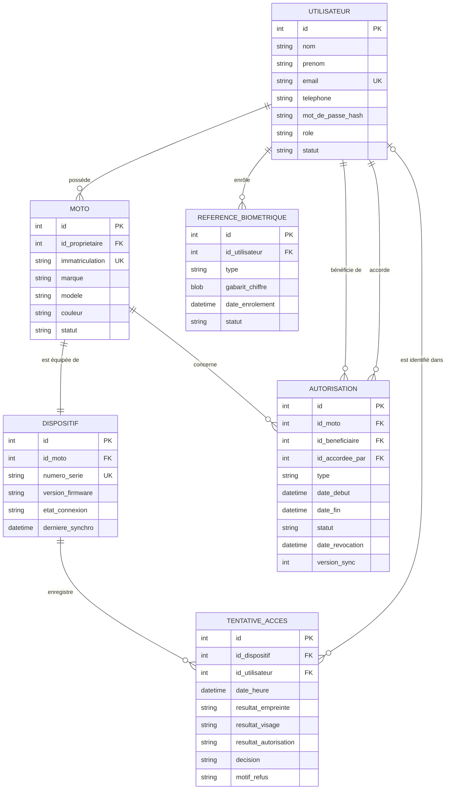

# Schéma de la base de données

Base **relationnelle**. Six tables.

## Description des tables

| Table | Colonnes principales |
|---|---|
| `UTILISATEUR` | id (PK), nom, prenom, email (unique), telephone, mot_de_passe_hash, role, statut |
| `MOTO` | id (PK), id_proprietaire (FK), immatriculation (unique), marque, modele, couleur, statut |
| `DISPOSITIF` | id (PK), id_moto (FK, unique), numero_serie (unique), version_firmware, etat_connexion, derniere_synchro |
| `REFERENCE_BIOMETRIQUE` | id (PK), id_utilisateur (FK), type (EMPREINTE ou VISAGE), gabarit_chiffre, date_enrolement, statut |
| `AUTORISATION` | id (PK), id_moto (FK), id_beneficiaire (FK), id_accordee_par (FK), type (PERMANENTE ou TEMPORAIRE), date_debut, date_fin (NULL si permanente), statut (ACTIVE, REVOQUEE, EXPIREE), date_revocation, version_sync |
| `TENTATIVE_ACCES` | id (PK), id_dispositif (FK), id_utilisateur (FK, nullable), date_heure, resultat_empreinte, resultat_visage, resultat_autorisation, decision, motif_refus |

## Cardinalités
- Un propriétaire possède 1..n motos.
- Une moto a exactement un dispositif.
- Une moto a 0..n autorisations.
- Un utilisateur a 0..n autorisations (donc peut être autorisé sur plusieurs motos).
- Un utilisateur a 0..2 références biométriques (une empreinte, un visage).
- Un dispositif enregistre 0..n tentatives ; l'utilisateur d'une tentative peut être inconnu (clé nullable).
