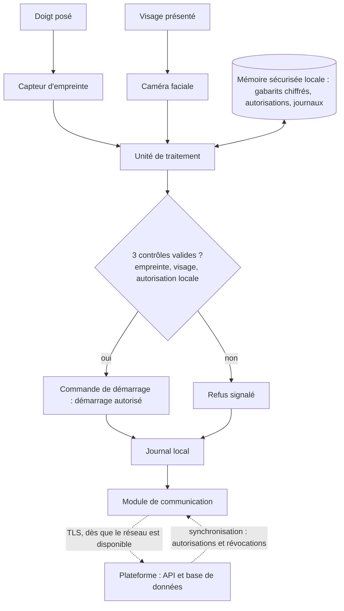

# Schéma complémentaire : fonctionnement du dispositif embarqué

Ce schéma n'est **pas** un sixième diagramme UML : il résume la chaîne de décision du dispositif.

## Règles de sûreté
- La commande de démarrage n'intervient **qu'à l'allumage**.
- Elle ne coupe **jamais** un moteur en marche.

## Fonctionnement hors connexion
Sans réseau, le dispositif vérifie localement les gabarits et l'autorisation synchronisée (avec son expiration), conserve les journaux, puis les envoie au retour du réseau.

## Composants physiques (modélisés, simulés)
Capteur d'empreinte · caméra faciale · unité de traitement · mémoire sécurisée locale · module de communication · commande de démarrage (relais) · alimentation protégée sur la batterie de la moto.
