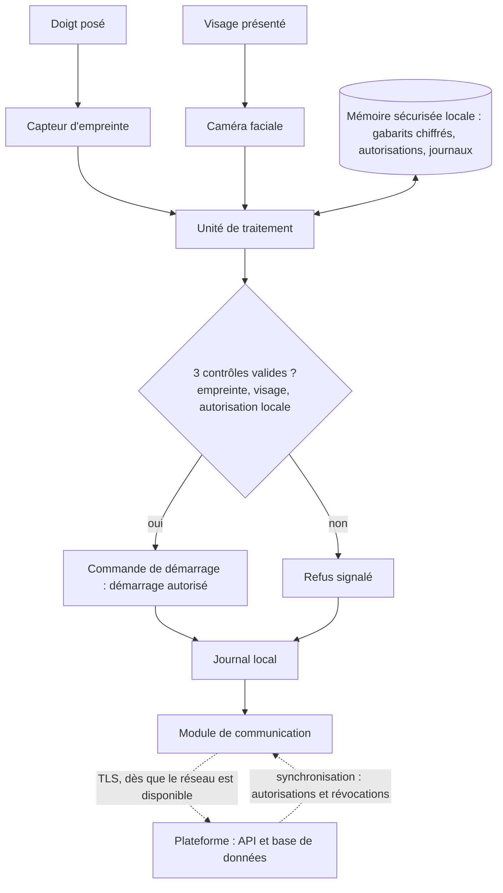

# Modélisation de la sécurisation biométrique des motos à double authentification (empreinte digitale et reconnaissance faciale) pour le campus de l'UNSTIM

**Dossier d'analyse et de conception logicielle**
Travail académique individuel — Génie logiciel
Établissement : UNSTIM
Auteur(e) : _à compléter_ · Enseignant : _à compléter_ · Année universitaire : _à compléter_
Version 1.1 — 26 novembre 2026
Dépôt GitHub : https://github.com/adanlaoade/modelisation-securisation-biometrique-motos

**Mots-clés :** sécurisation des motos, authentification biométrique à deux facteurs, empreinte digitale, reconnaissance faciale, système embarqué, application mobile, autorisations temporaires, UML, architecture en couches.

---

## Table des matières

1. [Introduction générale](#1-introduction-générale)
2. [Analyse et identification des besoins (Phase 1)](#2-analyse-et-identification-des-besoins-phase-1)
3. [Étude de faisabilité et planification (Phase 2)](#3-étude-de-faisabilité-et-planification-phase-2)
4. [Conception du logiciel (Phase 3)](#4-conception-du-logiciel-phase-3)
5. [Conclusion générale](#5-conclusion-générale)
6. [Références](#6-références)
7. [Livrables et traçabilité](#7-livrables-et-traçabilité)

---

## 1. Introduction générale

En janvier 2025, l'UNSTIM a enregistré quatre cas de vols de motos. Les cadenas et antivols classiques ne protègent pas contre la perte ou la copie d'une clé. La présidente des étudiants a donc lancé un hackathon pour concevoir un dispositif qui sécurise chaque moto par deux facteurs biométriques obligatoires : l'empreinte digitale et la reconnaissance faciale.

Ce dossier couvre les trois premières phases du cycle de vie logiciel : l'analyse des besoins, l'étude de faisabilité avec la planification, puis la conception. Le projet est une **simulation** : aucun matériel réel n'est fabriqué ni acheté. Les capteurs, l'unité de traitement et la commande de démarrage sont des composants modélisés (conçus et décrits), dont le comportement sera simulé par logiciel dans une éventuelle étape ultérieure. Ce dossier ne contient **aucune programmation**.

Il s'achève par cinq diagrammes UML réalisés dans Lucidchart (cas d'utilisation, classes, activités, composants en couches, séquences) et par un schéma du fonctionnement du dispositif embarqué. L'ensemble du travail est conservé sur GitHub : https://github.com/adanlaoade/modelisation-securisation-biometrique-motos

---

## 2. Analyse et identification des besoins (Phase 1)

### 2.1 Contexte et problématique

Les motos sont le moyen de transport principal de nombreux étudiants. Un vol prive l'étudiant de son moyen de déplacement et nuit à la confiance dans la sécurité du campus. La clé physique est le point faible : elle se perd, se copie et se prête sans contrôle.

**Problématique :** comment concevoir un système qui garantit que seules des personnes explicitement autorisées démarrent une moto donnée, qui permet au propriétaire de partager sa moto de façon contrôlée et limitée dans le temps, et qui reste utilisable sans connexion réseau permanente ?

### 2.2 Objectifs

**Objectif général :** empêcher le démarrage d'une moto par toute personne non autorisée.

**Objectifs spécifiques :**
1. Imposer deux facteurs biométriques (empreinte et visage) avant tout démarrage.
2. Permettre au propriétaire de gérer des autorisations permanentes ou temporaires.
3. Tracer toute utilisation et toute tentative d'accès.
4. Protéger les données biométriques.
5. Rester fonctionnel hors connexion dans des limites clairement définies.

### 2.3 Acteurs et rôles

| Acteur | Rôle |
|---|---|
| Propriétaire | Crée son compte, enregistre sa moto, ajoute des utilisateurs, accorde ou révoque des autorisations, consulte l'historique. Il est aussi utilisateur autorisé de sa propre moto. |
| Utilisateur autorisé | Ami, parent, proche ou mécanicien. Enrôle ses données biométriques et démarre la moto pendant la période autorisée. |
| Administrateur | Supervise la plateforme : comptes, motos, journaux techniques, état des dispositifs. |
| Dispositif embarqué (acteur secondaire) | Effectue les vérifications, commande le démarrage, journalise et se synchronise avec la plateforme. |

### 2.4 Besoins fonctionnels

| Réf. | Besoin |
|---|---|
| BF1 | Créer et gérer un compte (propriétaire, utilisateur, administrateur). |
| BF2 | Enregistrer une moto et l'associer à son dispositif embarqué. |
| BF3 | Enrôler les empreintes et les visages avec des capteurs compatibles avec le dispositif. |
| BF4 | Ajouter plusieurs utilisateurs autorisés pour une moto. |
| BF5 | Accorder une autorisation permanente ou temporaire, avec date et heure de début et de fin. |
| BF6 | Révoquer une autorisation. |
| BF7 | Vérifier l'empreinte, le visage et l'autorisation avant tout démarrage. |
| BF8 | Autoriser le démarrage uniquement si les trois contrôles réussissent. |
| BF9 | Journaliser chaque tentative d'accès (réussie ou refusée). |
| BF10 | Consulter l'historique des utilisations et des tentatives. |
| BF11 | Synchroniser les autorisations entre la plateforme et chaque dispositif. |
| BF12 | Superviser la plateforme (administration). |
| BF13 | Autoriser un même utilisateur sur plusieurs motos. |

### 2.5 Besoins non fonctionnels

| Catégorie | Exigence |
|---|---|
| Sécurité | Chiffrement des échanges (TLS), chiffrement des gabarits biométriques, authentification forte des comptes, limitation des essais échoués. |
| Confidentialité | Stockage de gabarits (références) et non d'images brutes ; minimisation des données ; consentement à l'enrôlement. |
| Performance | Décision de démarrage en quelques secondes. |
| Disponibilité | Fonctionnement local sans réseau avec les autorisations déjà synchronisées. |
| Fiabilité | Taux de faux rejets maîtrisé ; procédure de secours pour le propriétaire. |
| Sûreté | Le système ne coupe jamais le moteur d'une moto en circulation. |
| Ergonomie | Application simple, en français, utilisable sur smartphone. |
| Maintenabilité | Architecture modulaire en couches, mise à jour du micrologiciel. |
| Traçabilité | Journaux horodatés et non modifiables par l'utilisateur. |

### 2.6 Contraintes

- Projet de simulation : pas de réalisation matérielle ; les composants physiques sont modélisés et leur comportement est simulé.
- Dans un déploiement réel (hors périmètre), les capteurs devraient résister à la poussière, à la pluie, aux vibrations et à la température, et l'alimentation par la batterie de la moto devrait rester faible.
- Réseau mobile parfois instable : le mode hors connexion est obligatoire.
- Les données biométriques internes d'un téléphone ne sont pas exportables vers les capteurs de la moto : l'enrôlement se fait avec les capteurs du dispositif.
- Protection des données personnelles et consentement des personnes.

### 2.7 Périmètre

**Inclus :** analyse, faisabilité, planification, conception (architecture, base de données, interfaces, scénarios, cinq diagrammes UML).

**Exclus de ce travail :** fabrication ou achat de matériel, programmation de l'application, intégration de systèmes de paiement ou de géolocalisation, déploiement en production. Le dispositif embarqué est étudié comme un modèle conceptuel, dont les capteurs seront simulés (échantillons biométriques fictifs, horloge simulée).

---

## 3. Étude de faisabilité et planification (Phase 2)

### 3.1 Faisabilité technique

La simulation est techniquement faisable avec des outils logiciels courants : un simulateur du dispositif embarqué (capteurs remplacés par des entrées fictives, résultats de comparaison simulés, horloge simulée pour tester les autorisations temporaires), une API et une base de données. Les technologies réelles (lecteurs d'empreintes, caméras, microcontrôleurs, relais de commande) existent, ce qui garantit que la conception reste réaliste pour un éventuel déploiement futur. Le principal risque d'un déploiement réel, la fiabilité de la reconnaissance faciale en extérieur (lumière, casque, lunettes), est identifié mais n'est pas testé ici. Le projet est jugé techniquement faisable en simulation.

### 3.2 Faisabilité économique

| Poste | Coût |
|---|---|
| Matériel | Nul : aucun composant n'est acheté, les capteurs sont simulés. |
| Hébergement | Nul ou très faible : exécution locale ou offre gratuite d'un hébergeur. |
| Développement | Travail étudiant : coût monétaire nul, coût en temps. |
| Outils | Lucidchart et GitHub, offres accessibles à un étudiant. |

Le projet est économiquement faisable. Le coût d'un vrai dispositif par moto n'est pas évalué ici : il demanderait des devis de composants et sortirait du périmètre.

### 3.3 Faisabilité opérationnelle

Le travail est réalisable individuellement dans le temps imparti. La simulation permet de démontrer les scénarios principaux (démarrage nominal, autorisation temporaire, révocation, vol, mode hors connexion) devant l'enseignant, sans matériel. Pour un usage réel futur, l'usage quotidien resterait simple : poser le doigt puis présenter le visage.

### 3.4 Ressources nécessaires

| Type | Ressources |
|---|---|
| Matérielles | Un ordinateur personnel et un smartphone de test. Aucun capteur ni dispositif physique : les composants du dispositif embarqué sont simulés. |
| Humaines | Un étudiant ingénieur (analyse, conception) ; un encadrant enseignant. |
| Logicielles | Lucidchart (diagrammes), GitHub (versionnement), éditeur de documents, outils de modélisation de base de données. |

### 3.5 Risques et solutions

| Risque | Impact | Solution |
|---|---|---|
| Faux rejets du visage (lumière, casque) | Frustration, refus à tort | Seuil calibré, éclairage d'appoint, nouvel essai limité, secours du propriétaire. |
| Fuite de données biométriques | Atteinte grave à la vie privée | Gabarits chiffrés, pas d'images brutes, accès restreint, comparaison locale. |
| Absence de réseau | Autorisations non mises à jour | Copie locale des autorisations avec date d'expiration ; synchronisation dès le retour du réseau. |
| Révocation non reçue hors connexion | Utilisateur révoqué peut encore démarrer | Limite connue et documentée : durée de validité courte de la copie locale ; révocation effective à la prochaine synchronisation. |
| Sabotage ou arrachage du dispositif | Contournement | Boîtier inviolable, alerte de rupture de communication, journal de l'événement. |
| Coupure du moteur en roulant | Danger pour le conducteur | Règle de conception : la commande n'agit que sur l'autorisation de démarrage, jamais sur un moteur déjà en marche. |
| Écart entre simulation et réalité | Comportement réel différent (bruit des capteurs, lumière) | Limites documentées ; seuils et taux d'erreur traités comme paramètres du simulateur. |

### 3.6 Planification

| Étape | Contenu | Durée indicative |
|---|---|---|
| 1 | Analyse des besoins | 1 semaine |
| 2 | Faisabilité et planification | 1 semaine |
| 3 | Architecture et base de données | 1 semaine |
| 4 | Diagrammes UML dans Lucidchart | 1 semaine |
| 5 | Rapport final et dépôt GitHub | 1 semaine |
| 6 (étape suivante possible) | Simulation du dispositif et de l'API, tests des scénarios | à planifier |

---

## 4. Conception du logiciel (Phase 3)

### 4.1 Architecture générale

Le système comprend deux ensembles reliés. La **plateforme** (application mobile du propriétaire, interface d'administration, API, base de données) gère les comptes, les motos, les autorisations et l'historique. Le **dispositif embarqué**, propre à chaque moto, effectue les vérifications biométriques et commande le démarrage. Le dispositif est un sous-système distinct : il doit décider seul, même sans réseau.

### 4.2 Composants physiques du dispositif embarqué

Ces composants sont conçus et décrits comme un modèle : dans ce projet de simulation, aucun n'est fabriqué ni acheté, et leur comportement sera simulé par logiciel.

| Composant | Rôle |
|---|---|
| Capteur d'empreinte digitale (simulé) | Capture l'empreinte du doigt posé par l'utilisateur. |
| Caméra faciale | Capture le visage de l'utilisateur. |
| Unité de traitement | Compare les échantillons aux gabarits, contrôle l'autorisation et décide. |
| Mémoire sécurisée locale | Conserve les gabarits chiffrés, la copie des autorisations et la file des journaux. |
| Module de communication | Échange avec la plateforme (synchronisation, journalisation) de manière chiffrée. |
| Commande de démarrage | Relais qui autorise ou non le démarrage. |
| Alimentation | Prélève de l'énergie sur la batterie de la moto, avec protection. |

### 4.3 Utilisateurs et responsabilités

Le propriétaire répond de sa moto et des autorisations qu'il accorde. L'utilisateur autorisé respecte les conditions de sa période d'autorisation. L'administrateur supervise sans accéder aux données biométriques brutes. Le dispositif applique strictement les règles reçues.

### 4.4 Architecture logicielle en couches

L'architecture de référence à trois couches est pertinente et conservée. Un seul ajustement est apporté : la synchronisation des dispositifs est isolée dans un module de la couche de traitement, car elle porte les règles de révocation et d'expiration.

| Couche | Contenu |
|---|---|
| Présentation | Application mobile du propriétaire ; interface d'administration. |
| Traitement | API REST sécurisée ; modules métier : comptes, motos, autorisations, authentification biométrique, historique, synchronisation. |
| Données | Base de données relationnelle ; stockage sécurisé des références biométriques. |

Le sous-système embarqué est relié à la plateforme par l'API, en TLS.

### 4.5 Modules logiciels et responsabilités

| Module | Responsabilités |
|---|---|
| Gestion des comptes | Inscription, authentification, profils, rôles, verrouillage après essais échoués. |
| Gestion des motos | Enregistrement, association au dispositif, activation et désactivation. |
| Gestion des autorisations | Création permanente ou temporaire, calcul de validité, révocation. |
| Authentification biométrique | Gestion de l'enrôlement et des références ; règles de décision. |
| Historique et journalisation | Enregistrement et consultation des tentatives et utilisations. |
| Synchronisation des dispositifs | Envoi des autorisations et révocations ; réception des journaux ; versionnement. |

### 4.6 Conception de la base de données

Le choix retenu est une base relationnelle : les données sont structurées et les relations (propriétaire–moto, moto–autorisation, utilisateur–autorisation) sont naturelles.

| Table | Colonnes principales |
|---|---|
| UTILISATEUR | id (PK), nom, prenom, email (unique), telephone, mot_de_passe_hash, role, statut |
| MOTO | id (PK), id_proprietaire (FK), immatriculation (unique), marque, modele, couleur, statut |
| DISPOSITIF | id (PK), id_moto (FK, unique), numero_serie (unique), version_firmware, etat_connexion, derniere_synchro |
| REFERENCE_BIOMETRIQUE | id (PK), id_utilisateur (FK), type (EMPREINTE ou VISAGE), gabarit_chiffre, date_enrolement, statut |
| AUTORISATION | id (PK), id_moto (FK), id_beneficiaire (FK), id_accordee_par (FK), type (PERMANENTE ou TEMPORAIRE), date_debut, date_fin (NULL si permanente), statut (ACTIVE, REVOQUEE, EXPIREE), date_revocation, version_sync |
| TENTATIVE_ACCES | id (PK), id_dispositif (FK), id_utilisateur (FK, nullable), date_heure, resultat_empreinte, resultat_visage, resultat_autorisation, decision, motif_refus |

**Cardinalités :** un propriétaire possède 1..n motos ; une moto a exactement un dispositif ; une moto a 0..n autorisations ; un utilisateur a 0..n autorisations et 0..2 références biométriques (une empreinte, un visage, selon l'enrôlement) ; un dispositif enregistre 0..n tentatives. La table AUTORISATION relie les utilisateurs aux motos : un utilisateur peut donc être autorisé sur plusieurs motos.

**Schéma entité-relation :** voir [`../docs/04-schema-base-de-donnees.md`](../docs/04-schema-base-de-donnees.md).

### 4.7 Interfaces utilisateur

| Écran | Contenu |
|---|---|
| Connexion et inscription | Formulaire, récupération du mot de passe. |
| Tableau de bord | Liste des motos, état du dispositif, dernières activités. |
| Enregistrement d'une moto | Immatriculation, marque, modèle, appairage du dispositif. |
| Utilisateurs autorisés | Liste, ajout, état de l'enrôlement. |
| Gestion des autorisations | Choix permanent ou temporaire, sélection des dates et heures, révocation. |
| Historique | Liste filtrable des utilisations et tentatives, avec résultat. |
| Administration | Comptes, motos, dispositifs, journaux techniques. |

### 4.8 Interactions entre acteurs et système

Le propriétaire passe par l'application mobile : elle appelle l'API, qui met à jour la base. À la prochaine synchronisation, le dispositif reçoit la nouvelle liste d'autorisations. L'utilisateur interagit uniquement avec le dispositif de la moto (doigt, puis visage). L'administrateur utilise l'interface d'administration.

### 4.9 Scénarios pratiques

**Scénario 1 : démarrage nominal.** Un utilisateur autorisé pose son doigt, présente son visage ; le dispositif vérifie les deux gabarits puis l'autorisation locale ; il autorise le démarrage et journalise.

**Scénario 2 : autorisation temporaire.** Le propriétaire autorise un mécanicien de 9 h à 17 h le même jour. À 17 h 01, la copie locale est expirée : le démarrage est refusé sans besoin de réseau.

**Scénario 3 : révocation.** Le propriétaire révoque une autorisation. Si le dispositif est connecté, il la reçoit presque immédiatement. S'il est hors connexion, il ne peut pas la connaître : la révocation s'applique à la prochaine synchronisation, ce qui est une limite assumée.

**Scénario 4 : vol.** Un voleur ne possède ni l'empreinte ni le visage d'un utilisateur autorisé : le démarrage est refusé, la tentative est journalisée et le propriétaire la voit dans l'historique.

**Scénario 5 : mode hors connexion.** Sans réseau, le dispositif vérifie localement les gabarits et l'autorisation synchronisée, stocke les journaux, puis les envoie au retour du réseau.

### 4.10 Les cinq diagrammes UML

Les cinq diagrammes ont été construits dans Lucidchart et sont modifiables individuellement.

| N° | Diagramme | Lien Lucidchart |
|---|---|---|
| 1 | Cas d'utilisation | https://lucid.app/lucidchart/9a4ebf0b-6770-41ef-99bb-a27063f30b32/edit |
| 2 | Classes | https://lucid.app/lucidchart/b0ba8773-c643-4c7e-8382-7cc05d71aa14/edit |
| 3 | Activités | https://lucid.app/lucidchart/3e1a5c8b-5b49-432b-8678-06f10d6c99b4/edit |
| 4 | Composants en couches | https://lucid.app/lucidchart/9bd4dd57-efcf-47e6-9494-79717662b0c6/edit |
| 5 | Séquences | https://lucid.app/lucidchart/e92d5f79-ded3-4f4c-b0ed-070367f0af91/edit |

#### 4.10.1 Diagramme de cas d'utilisation

<!-- Activer après dépôt de l'image :  -->
_Image : `diagrammes/images/01-cas-utilisation.png`._

Le système contient seize cas d'utilisation. Le Propriétaire hérite de l'Utilisateur autorisé (généralisation) : il peut donc démarrer et enrôler ses données, en plus de gérer compte, motos, autorisations et historique. « Démarrer la moto » inclut quatre cas : vérifier l'empreinte, vérifier le visage, contrôler l'autorisation d'accès et enregistrer la tentative. « Définir la période de validité » étend « Accorder une autorisation » : il n'intervient que pour une autorisation temporaire. L'Administrateur supervise la plateforme. Le Dispositif embarqué est un acteur secondaire qui réalise les contrôles et la synchronisation.

#### 4.10.2 Diagramme de classes

<!-- Activer après dépôt de l'image :  -->
_Image : `diagrammes/images/02-classes.png`._

Les classes Propriétaire et Administrateur spécialisent Utilisateur. Un propriétaire possède 1..n motos ; chaque moto est équipée d'un unique dispositif. Une Autorisation relie un utilisateur bénéficiaire à une moto ; sa méthode `estValide(instant)` applique le statut, les dates et l'expiration. Une Référence biométrique appartient à un utilisateur (composition) et ne contient qu'un gabarit chiffré. Le dispositif enregistre des tentatives d'accès, éventuellement rattachées à un utilisateur identifié. Les types énumérés (statuts, types) sont cités comme types d'attributs mais non dessinés, pour garder le diagramme lisible. L'association « accordée par » (propriétaire vers autorisation) est portée dans la base par la clé `id_accordee_par`.

#### 4.10.3 Diagramme d'activités

<!-- Activer après dépôt de l'image :  -->
_Image : `diagrammes/images/03-activites.png`._

Trois couloirs (Utilisateur, Dispositif embarqué, Plateforme) décrivent le démarrage. L'utilisateur pose son doigt ; le dispositif vérifie l'empreinte. Si elle est valide, l'utilisateur présente son visage, vérifié à son tour. Le dispositif contrôle ensuite l'autorisation locale. Toute vérification négative conduit au refus. Dans tous les cas, la tentative est enregistrée dans l'historique de la plateforme (immédiatement ou après synchronisation).

#### 4.10.4 Diagramme de composants en couches

<!-- Activer après dépôt de l'image :  -->
_Image : `diagrammes/images/04-composants.png`._

Le diagramme montre les trois couches (présentation, traitement, données), les six modules métier regroupés derrière l'API REST, et le sous-système embarqué avec ses sept éléments principaux. La liaison TLS entre le module de communication du dispositif et l'API est la seule passerelle entre les deux ensembles.

#### 4.10.5 Diagramme de séquences

<!-- Activer après dépôt de l'image :  -->
_Image : `diagrammes/images/05-sequences.png`._

Les messages suivent l'ordre : empreinte, puis visage, puis autorisation locale, puis commande de démarrage. Trois fragments « alt » imbriqués traduisent les refus possibles. Un fragment « opt » représente l'envoi de la tentative à la plateforme lorsque la connexion est disponible. Une note rappelle la conservation locale hors connexion.

### 4.11 Schéma complémentaire : fonctionnement du dispositif embarqué

Ce schéma n'est pas un sixième diagramme UML. Il résume la chaîne de décision du dispositif.

**Règles de sûreté :** la commande de démarrage n'intervient qu'à l'allumage ; elle ne coupe jamais un moteur en marche.

### 4.12 Règles de conception importantes

1. **Deux facteurs obligatoires :** empreinte et visage doivent tous deux être valides.
2. **Multi-motos :** une autorisation relie un utilisateur à une moto ; il peut en avoir plusieurs.
3. **Autorisation temporaire :** le dispositif compare l'heure courante à `date_debut` et `date_fin` ; hors période, refus.
4. **Révocation :** elle bloque tout nouveau démarrage dès que le dispositif a reçu la mise à jour. Un dispositif hors connexion ne peut pas l'appliquer avant la prochaine synchronisation ; pour limiter ce risque, la copie locale d'une autorisation a une durée de validité courte, à renouveler à chaque synchronisation.
5. **Mode hors connexion :** les autorisations déjà synchronisées sont vérifiées localement en tenant compte de leur expiration.
6. **Sûreté :** jamais de coupure moteur en circulation.
7. **Protection biométrique :** seuls des gabarits chiffrés sont stockés ; pas d'images brutes conservées.
8. **Enrôlement :** il se fait avec les capteurs du dispositif (ou des capteurs compatibles), car les données biométriques internes d'un téléphone ne sont pas exportables.

---

## 5. Conclusion générale

Ce dossier propose une conception complète d'un système de sécurisation biométrique des motos : besoins clarifiés, faisabilité argumentée, architecture en couches validée, base de données, interfaces, scénarios et cinq diagrammes UML modifiables dans Lucidchart. Les points délicats ont reçu une réponse explicite : double authentification obligatoire, autorisations temporaires, révocation, mode hors connexion avec sa limite connue, protection des données biométriques et sûreté en circulation. Le projet restant une simulation sans matériel réel, la prochaine étape logique est le développement d'un simulateur du dispositif embarqué, de l'API et de l'application, hors périmètre de ce dossier.

---

## 6. Références

- Cours de génie logiciel et de modélisation UML de l'enseignant (référence principale).
- OMG, *Unified Modeling Language (UML) Specification*, omg.org.
- Lucid Software, documentation de Lucidchart, lucid.co.
- ISO/IEC 19794 (formats d'échange de données biométriques) et ISO/IEC 30107 (détection d'attaques de présentation) : normes de référence en biométrie, à consulter pour la suite du projet.

---

## 7. Livrables et traçabilité

- **Dépôt GitHub :** https://github.com/adanlaoade/modelisation-securisation-biometrique-motos
- **Diagrammes Lucidchart :** tableau de la section 4.10.
- **Documents de travail :** matrice de traçabilité, décisions de conception, schémas (dossier `docs/`).
- **Historique des versions :** `CHANGELOG.md`.
